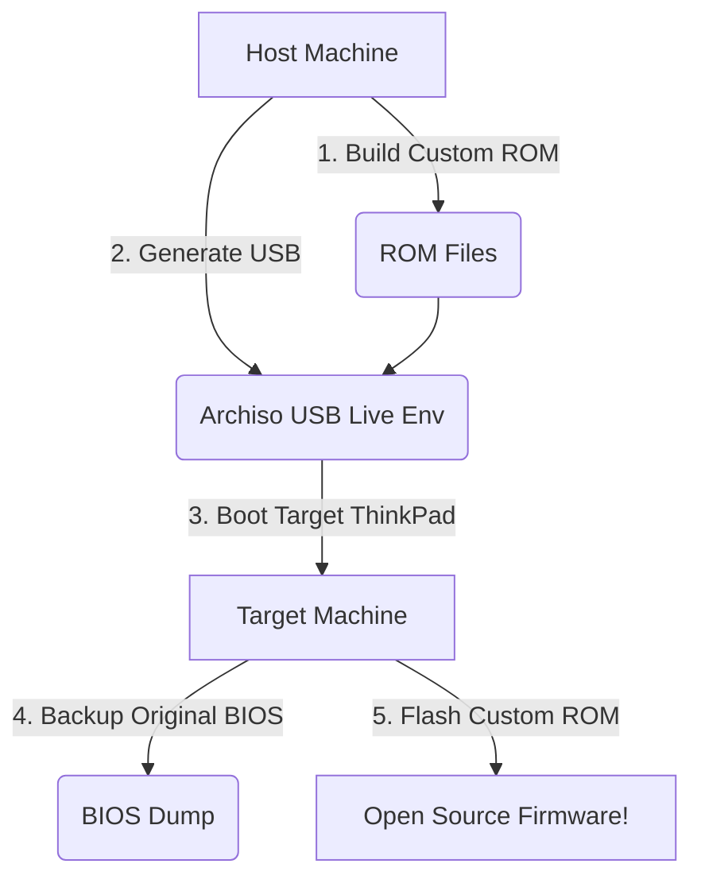

# Libre_Core AutoLoader

```text
 _      _ _                 _____               
| |    (_) |               /  __ \              
| |     _| |__  _ __ ___   | /  \/___  _ __ ___ 
| |    | | '_ \| '__/ _ \  | |   / _ \| '__/ _ \
| |____| | |_) | | |  __/  | \__/\ (_) | | |  __/
\_____/|_|_.__/|_|  \___|   \____/\___/|_|  \___|
           A u t o L o a d e r
```


## What is Libre_Core AutoLoader?

Libre_Core AutoLoader is a comprehensive, USB-bootable ThinkPad firmware modification toolkit. It provides an automated, menu-driven interface (TUI) to simplify the process of replacing proprietary BIOS with open-source firmware like Coreboot, Libreboot, and Canoeboot on classic ThinkPad models.

## Supported ThinkPad Models

| Model | Generation | IVprep Support | 1vyrain Support | Firmware Options |
|-------|------------|----------------|-----------------|------------------|
| X200  | Core 2 Duo | No | No | Coreboot, Libreboot, Canoeboot |
| X201  | Arrandale | No | No | Coreboot, Canoeboot |
| X220  | Sandy Bridge | No | No | Coreboot, Libreboot, Canoeboot |
| X230  | Ivy Bridge | Yes | Yes | Coreboot, Libreboot, Canoeboot |
| T400  | Core 2 Duo | No | No | Coreboot, Libreboot, Canoeboot |
| T420  | Sandy Bridge | No | No | Coreboot, Libreboot, Canoeboot |
| T430  | Ivy Bridge | Yes | Yes | Coreboot, Libreboot, Canoeboot |
| T440p | Haswell | No | No | Coreboot, Libreboot, Canoeboot |
| T480  | Kaby Lake | No | No | Coreboot, Libreboot |
| T500  | Core 2 Duo | No | No | Coreboot, Libreboot, Canoeboot |

## Features

* **Auto-detect ThinkPad model and BIOS version**
* **Automated BIOS reversion via IVprep (xx30 series)**
* **1vyrain exploit integration for software-based flashing**
* **Custom Coreboot/Libreboot/Canoeboot ROM builder**
* **Menu-driven payload selection (SeaBIOS, GRUB, TianoCore)**
* **Intel ME neutering via me_cleaner**
* **WiFi/battery whitelist removal**
* **Custom bootsplash screen support**
* **EC firmware modification (classic keyboard, battery bypass)**
* **Interactive step-by-step flashing guides with ASCII diagrams**
* **Automatic ROM backup with double-read verification**
* **USB-bootable live Linux environment**
* **Two-stage workflow (configure on host, flash from USB)**

## Quick Start

### Installation

```bash
git clone https://github.com/Libre-Core/AutoLoader.git
cd AutoLoader
pip install -r requirements.txt
pip install -e .
```

### Usage Modes

1. **Host mode (pip install, run from desktop):**
   Use this mode to configure ROMs and prepare the USB environment on your main workstation.
   ```bash
   autoloader run
   ```

2. **USB mode (boot from USB on target ThinkPad):**
   The built ISO drops you right into the TUI, fully equipped with `flashrom` and other utilities to flash the target machine.

3. **CLI mode (individual commands):**
   For scripting and advanced usage.
   ```bash
   autoloader --help
   autoloader generate-usb --output ./out
   ```

## Building the USB Image

1. Prepare your ROMs on the host machine using the AutoLoader UI.
2. Build the Arch Linux-based Live USB:
   ```bash
   sudo ./usb_builder/build_usb.sh --output-dir ./iso_out --include-roms ./workspace/roms
   ```
3. Flash the resulting `.iso` to a USB drive using Rufus, balenaEtcher, or Ventoy.
4. Boot the target ThinkPad from the USB drive.

## Two-Stage Workflow



## Supported Firmware

| Feature | Coreboot | Libreboot | Canoeboot |
|---------|----------|-----------|-----------|
| **Philosophy** | Pragmatic | 100% Free Software | Blob-reduced |
| **Intel ME** | Neutered | Removed/Disabled | Neutered |
| **Microcode** | Yes (Intel) | No | Yes |
| **Payloads** | SeaBIOS, TianoCore | GRUB, SeaBIOS | GRUB, SeaBIOS |

## Safety

> [!WARNING]
> Flashing custom firmware modifies your motherboard's SPI flash chip. If something goes wrong, you could "brick" your device.
> * ALWAYS create and verify backups of your original BIOS before flashing.
> * Have a hardware SPI programmer (like a CH341A) ready just in case.
> * Ensure your laptop is plugged into AC power and the battery is charged.

## Architecture

```mermaid
graph LR
    UI[Textual TUI] --> State[State Manager]
    State --> Worker[Async Workers]
    Worker --> Modules[Core Modules]
    Modules --> Ext[External Tools (flashrom, me_cleaner)]
    Modules --> Builder[ROM Builder]
    Modules --> Exploits[1vyrain / IVprep]
```

## Contributing

Contributions are welcome! Please submit Pull Requests on GitHub. Make sure your code passes linting and includes appropriate type hints.

## License

This project is licensed under the GPL-3.0 License - see the [LICENSE](LICENSE) file for details.

## Acknowledgements

* **1vyrain**: Software-based flashing for xx30 series
* **coreboot, libreboot, canoeboot**: The core firmware projects
* **me_cleaner**: Intel ME deblobbing
* **thinkpad-ec**: Embedded Controller firmware modifications
* **flashrom**: The universal flash programming utility
* **Skulls**: Inspiration for pre-configured ROMs
