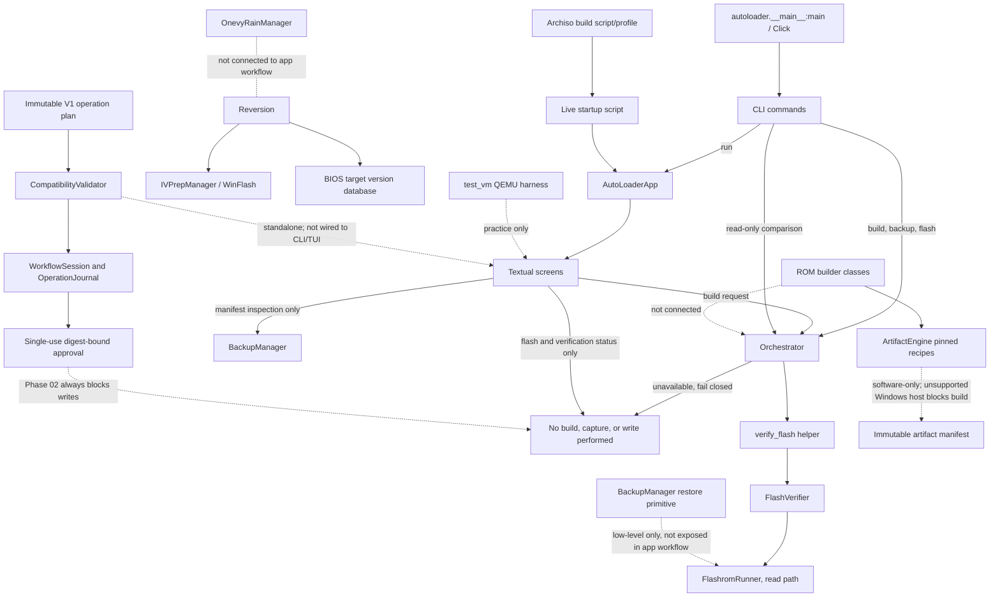

# Current architecture and Phases 02–04 safety/build services

## Current call paths

At baseline, the CLI `flash` path bypassed the orchestrator while TUI build and flash completion were simulated. Phase 01 quarantines all application CLI physical writes, routes build/backup/flash requests to explicit unavailable outcomes, and removes false success. The TUI's build request uses the same orchestrator; capture and write controls remain disabled. Verification uses the shared orchestrator and can perform a read-only comparison when invoked.

Phase 02 adds a standalone workflow safety core in `autoloader/workflow/`. It uses three immutable V1 profiles, cross-checked raw DMI/MTM/BIOS evidence, exact chip/programmer/artifact checks, a tri-state validator, and a durable checksummed operation journal. Each record includes an operation ID, UTC timestamps, state transition, device fingerprint, artifact provenance/content metadata, backup capture/content checksums and failure details. Checkpoints are atomically replaced and corruption is rejected. Only DRAFT, VALIDATED and BACKUP_VERIFIED checkpoints can be resumed; resume requires the exact evidence fingerprints, revalidation, and a fresh human approval. BLOCKED, FAILED and WRITE_BLOCKED records are read-only inspection records. AUTHORIZED and later checkpoints are never resumable. The core is not yet connected to the CLI/TUI or any hardware backend; `WorkflowSession.request_write` always returns `WRITES_DISABLED_PHASE_02` and never invokes a writer. CLI/TUI unification and hardware I/O remain later phases.

Phase 03 software scope was accepted by SOL at `448766a`. The standalone `autoloader/flasher` services add strict read-only flashrom command validation, SPI probe evidence, observed-topology backup capture, persistent backup verification, region-aware read-back comparison and recovery-readiness records. They are exercised with fake transports and software fixtures only; they are not integrated into the CLI/TUI or the workflow engine. No physical SPI probe/read, voltage measurement, backup, firmware compilation/write, post-write read-back, recovery or boot test occurred. Every application writer and restore entrypoint remains hard-blocked; no writer is enabled.

SOL accepted the Phase 04 software scope at implementation commit `dec5cf903c8c4d09b464f14a38d84207f24a523a` and corrective commit `7c5b14e270c34b4a9856dfbcafdec029be011c8e`. `autoloader/rom_builder/artifact_engine.py` adds immutable recipes and manifests for pinned Coreboot 26.09/X220 and Libreboot 26.01/regular-X200, plus a T430 official-source 1vyrain handoff descriptor only. Legacy builder APIs fail closed, and the fabricated prebuilt catalog/download path was removed. The engine requires clean exact commit/tree/file hashes, strict resolved Kconfig, exact artifact size/hash and parsed CBFS payload inventory. X220 pre-build checks are bound to artifact-independent build intent and matching original full-chip backup evidence; after generation, exact descriptor/ME/GbE slices, original/generated IFD map agreement, CBFS inventory and byte preservation of all non-BIOS regions are checked before the generated artifact digest is bound into the final operation plan. For X200 it validates and records all 31 ROM variants expected from the pinned target/config/keymap inventory, then selects only the recipe's exact SeaBIOS/corebootfb image and checks it with cbfstool from lbmk's exact nested Coreboot commit/tree. Source checkouts and output roots must be outside the application tree. This Windows host lacks Linux build tooling, so builds return `LINUX_BUILD_ENV_REQUIRED` before build subprocesses or output creation. No upstream firmware compilation or artifact production occurred; fake parser/command tests are not compile or hardware evidence. The engine is not wired into CLI/TUI or the workflow state machine.

Phase 06 adds the standalone `autoloader.workflow.x200_libreboot.X200LibrebootWorkflow` adapter. It binds validated X200 build intent, the accepted backup/recovery services, a completed Phase 04 artifact manifest, a final operation plan, and a durable `BACKUP_VERIFIED` journal checkpoint before proposing a whole-chip SPI plan. Resume revalidates the exact plan and cannot restore an approval. The adapter stops at `STAGED/HARDWARE_PENDING`; flash and restore calls remain blocked. It is not integrated into CLI/TUI, and the fake transport/artifact fixtures provide software evidence only. No Linux firmware build, physical SPI probe/read, backup, write, read-back, recovery, or boot test occurred. SOL review is pending.

## Main modules

| Concern | Current modules |
|---|---|
| Entry and configuration | `autoloader/__main__.py`, `autoloader/app.py`, `autoloader/config.py` |
| Shared state/work | `autoloader/orchestrator.py` |
| Detection and compatibility data | `autoloader/detection/*`, `autoloader/database/*` |
| ROM preparation | `autoloader/rom_builder/*` |
| Phase 04 artifact preparation | `autoloader/rom_builder/artifact_engine.py` (pinned recipes/manifests; not integrated; no actual build on this host) |
| Phase 06 X200 Libreboot staging | `autoloader/workflow/x200_libreboot.py` (standalone evidence-bound staging adapter; durable journal; no writer or app integration) |
| Flash, verification, backup | `autoloader/flasher/*` |
| Phase 03 SPI evidence, backup/read-back and recovery readiness | `autoloader/flasher/*` (standalone services; fake-transport tested, not wired to app workflow) |
| 1vyrain unlock | `autoloader/flasher/onevy.py` (`OnevyRainManager`) |
| BIOS targets and downgrade | `autoloader/database/bios_versions.py`, `autoloader/reversion/{chains,ivprep,winflash}.py` |
| Backup restore | `autoloader/flasher/backup.py` (`restore_from_backup`, physical write surface) |
| UI | `autoloader/ui/screens/*`, `autoloader/ui/widgets/*` |
| Live USB | `usb_builder/build_usb.sh`, `usb_builder/archiso_profile/*` |
| VM/practice harness | `test_vm/launch_vm.py`, `test_vm/launch_vm.bat`, `test_vm/mock_chips/*` |
| Tests | `tests/*` |
| V1 evidence, policy, journal and workflow state | `autoloader/workflow/{types,profiles,compatibility,authorization,engine,journal}.py` |

## Target direction

Phases 01–02 quarantine physical CLI writes, remove fake completion paths, and implement the model-specific validated operation plan. Phase 02 policy deliberately ignores broad database support flags and fails closed on missing/conflicting evidence. Phase 03 software services were accepted at `4ba1858` and `448766a`, but remain standalone and read-only; they are not integrated into CLI/TUI. Phase 04 software scope was accepted by SOL at `dec5cf9` and `7c5b14e`; execution of pinned builds on supported Linux, generated-ROM CBFS parser evidence, and CLI/TUI integration remain pending. The CBFS schema and parser code are source-pinned but no generated-ROM parser output has been captured on Linux. No physical probe/read, measured voltage, backup, firmware build/write, read-back, recovery or boot test was performed, and no writer is enabled. Real-device hardware validation remains pending for all three workflows.

Phase 06 software is implemented at `91ec91e` and awaits SOL review. It adds only an X200 workflow that accepts synthetic/software evidence and proposes a blocked hardware plan; it neither compiles firmware on this Windows host nor performs any physical operation. Phase 06 is not accepted, and X200 physical validation remains pending.
