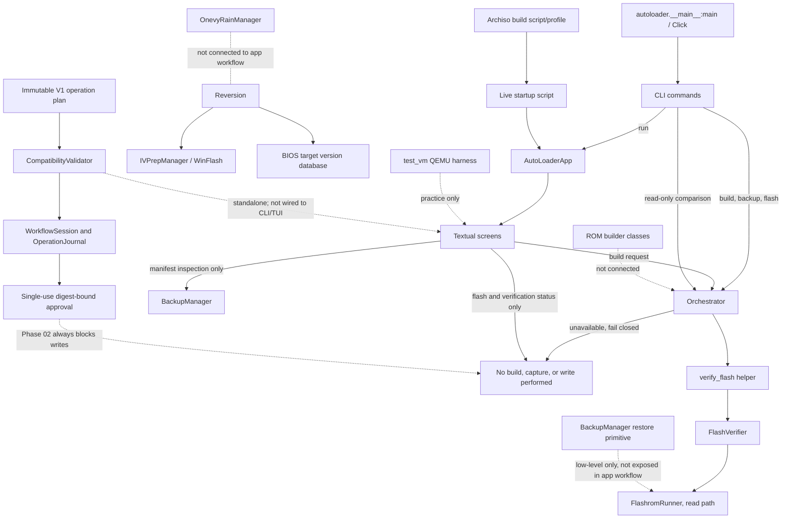

# Current architecture and Phase 02 safety core

## Current call paths

At baseline, the CLI `flash` path bypassed the orchestrator while TUI build and flash completion were simulated. Phase 01 quarantines all application CLI physical writes, routes build/backup/flash requests to explicit unavailable outcomes, and removes false success. The TUI's build request uses the same orchestrator; capture and write controls remain disabled. Verification uses the shared orchestrator and can perform a read-only comparison when invoked.

Phase 02 adds a standalone workflow safety core in `autoloader/workflow/`. It uses three immutable V1 profiles, raw detection evidence, exact chip/programmer/artifact checks, a tri-state validator, an append-only in-memory journal, and one-use approvals bound to current plan and file digests. The core is not yet connected to the CLI/TUI or any hardware backend; `WorkflowSession.request_write` always returns `WRITES_DISABLED_PHASE_02` and never invokes a writer. CLI/TUI unification and hardware I/O remain later phases.

## Main modules

| Concern | Current modules |
|---|---|
| Entry and configuration | `autoloader/__main__.py`, `autoloader/app.py`, `autoloader/config.py` |
| Shared state/work | `autoloader/orchestrator.py` |
| Detection and compatibility data | `autoloader/detection/*`, `autoloader/database/*` |
| ROM preparation | `autoloader/rom_builder/*` |
| Flash, verification, backup | `autoloader/flasher/*` |
| 1vyrain unlock | `autoloader/flasher/onevy.py` (`OnevyRainManager`) |
| BIOS targets and downgrade | `autoloader/database/bios_versions.py`, `autoloader/reversion/{chains,ivprep,winflash}.py` |
| Backup restore | `autoloader/flasher/backup.py` (`restore_from_backup`, physical write surface) |
| UI | `autoloader/ui/screens/*`, `autoloader/ui/widgets/*` |
| Live USB | `usb_builder/build_usb.sh`, `usb_builder/archiso_profile/*` |
| VM/practice harness | `test_vm/launch_vm.py`, `test_vm/launch_vm.bat`, `test_vm/mock_chips/*` |
| Tests | `tests/*` |
| V1 evidence and workflow policy | `autoloader/workflow/{types,profiles,compatibility,authorization,engine}.py` |

## Target direction

Phases 01–02 quarantine physical CLI writes, remove fake completion paths, and implement the model-specific validated operation plan. Phase 02 policy deliberately ignores broad database support flags and fails closed on missing/conflicting evidence. Phase 03 must add a separate write/read/backup backend only after probing and backup/recovery checks are designed and reviewed. Later CLI/TUI integration should use this service; no simulation may invoke physical writes. Real-device hardware validation remains a separate acceptance layer.
