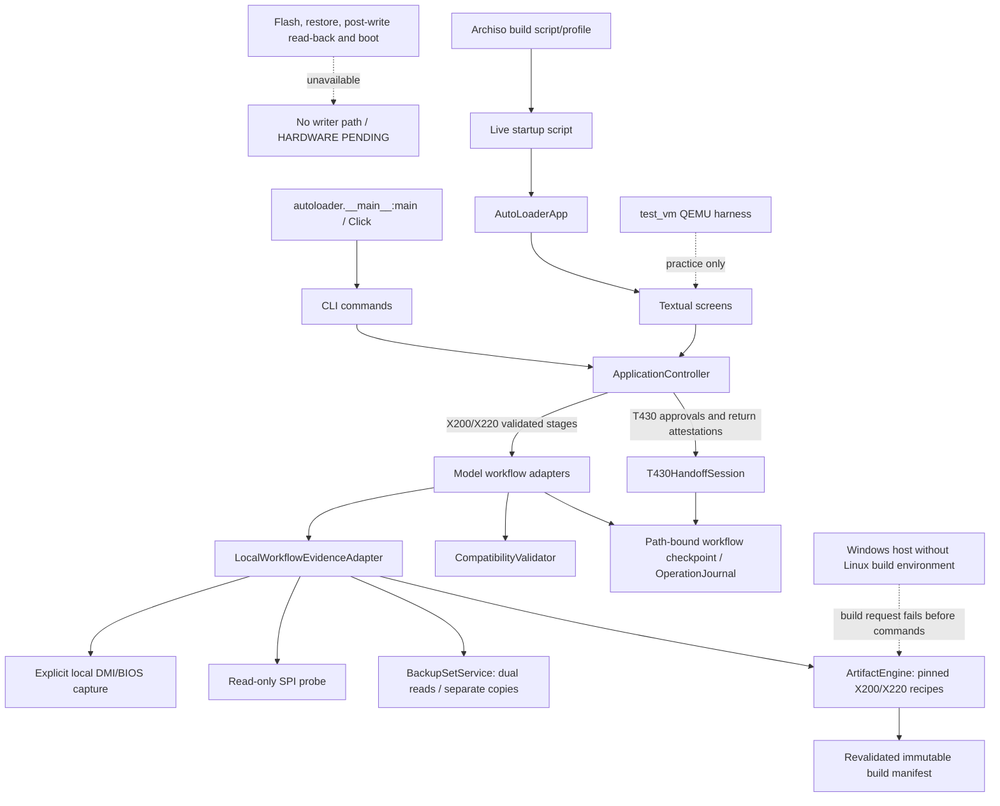

# Current architecture and Phase 08 application integration

## Current call paths

At baseline, the CLI `flash` path bypassed the orchestrator while TUI build and flash completion were simulated. Phase 01 removed false success and quarantined writes. Phase 08 now makes `ApplicationController` the shared route for CLI and Textual profile actions. Explicit X200/X220 preparation captures local identity and uses read-only SPI probe/region inspection; explicit backup reads the full chip twice and validates separate persistent copies. These are read-only hardware operations, but none were invoked during this development pass. The T430 route submits human approvals and fresh post-reboot return attestations without running IVprep or 1vyrain. Build actions call only the pinned ArtifactEngine; this Windows host fails with `LINUX_BUILD_ENV_REQUIRED` before a build command or output is created.

Phase 02 adds the shared workflow safety core in `autoloader/workflow/`. It uses three immutable V1 profiles, cross-checked raw DMI/MTM/BIOS evidence, exact chip/programmer/artifact checks, a tri-state validator, and a durable checksummed operation journal. Each record includes operation ID, UTC timestamps, state transition, device fingerprint, artifact provenance/content metadata, backup capture/content checksums and failure details. Checkpoints are atomically replaced and corruption is rejected. Standalone X200/X220 workflow checkpoints bind exact operation plans and require fresh identity, probe and service-level revalidation on resume. Candidate JSON cannot construct trusted backup or artifact results. T430 uses its own durable handoff checkpoint and fresh stage-specific return attestation. Physical writes and restores remain unavailable.

Phase 03 software scope was accepted by SOL at `448766a`. The `autoloader/flasher` services add strict read-only flashrom command validation, SPI probe evidence, observed-topology backup capture, persistent backup verification, region-aware read-back comparison and recovery-readiness records. Phase 08 integrates the probe and backup/recovery evidence paths for explicit X200/X220 prepare and backup actions. The region comparator and post-write read-back service remain unavailable from the app. Tests use fake transports and software fixtures only. No physical SPI probe/read, voltage measurement, backup, firmware compilation/write, post-write read-back, recovery or boot test occurred. Every application writer and restore entrypoint remains hard-blocked; no writer is enabled.

SOL accepted the Phase 04 software scope at implementation commit `dec5cf903c8c4d09b464f14a38d84207f24a523a` and corrective commit `7c5b14e270c34b4a9856dfbcafdec029be011c8e`. `autoloader/rom_builder/artifact_engine.py` adds immutable recipes and manifests for pinned Coreboot 26.09/X220 and Libreboot 26.01/regular-X200, plus a T430 official-source 1vyrain handoff descriptor only. Legacy builder APIs fail closed, and the fabricated prebuilt catalog/download path was removed. The engine requires clean exact commit/tree/file hashes, strict resolved Kconfig, exact artifact size/hash and parsed CBFS payload inventory. X220 pre-build checks are bound to artifact-independent build intent and matching original full-chip backup evidence; after generation, exact descriptor/ME/GbE slices, original/generated IFD map agreement, CBFS inventory and byte preservation of all non-BIOS regions are checked before the generated artifact digest is bound into the final operation plan. For X200 it validates and records all 31 ROM variants expected from the pinned target/config/keymap inventory, then selects only the recipe's exact SeaBIOS/corebootfb image and checks it with cbfstool from lbmk's exact nested Coreboot commit/tree. Source checkouts and output roots must be outside the application tree. This Windows host lacks Linux build tooling, so builds return `LINUX_BUILD_ENV_REQUIRED` before build subprocesses or output creation. No upstream firmware compilation or artifact production occurred; fake parser/command tests are not compile or hardware evidence. Phase 08 routes the engine through explicit CLI/TUI build requests, which fail before compilation/output on this Windows host.

Phase 06 software was accepted by SOL at commits `91ec91e` and `b06293e`. The `autoloader.workflow.x200_libreboot.X200LibrebootWorkflow` adapter binds validated X200 build intent, the accepted backup/recovery services, a completed Phase 04 artifact manifest, a final operation plan, and a durable `BACKUP_VERIFIED` journal checkpoint before proposing a whole-chip SPI plan. Phase 08 invokes its accepted software stages through the shared controller. Artifact acceptance requires exactly one non-empty `fallback/payload` entry of type `payload`; resume revalidates the exact plan. The only positive outcome remains `STAGED/HARDWARE_PENDING`.

Phase 07 software was accepted by SOL for X220 staging. Phase 08 routes preparation, backup, X220 backup-derived descriptor/ME/GbE build inputs, artifact acceptance and safe resume through the same application controller. A synthetic controller test verifies the three validated blobs reach the artifact engine; it does not compile firmware. The actual pinned Linux build and generated-ROM parser output are still pending.

## Main modules

| Concern | Current modules |
|---|---|
| Entry and configuration | `autoloader/__main__.py`, `autoloader/app.py`, `autoloader/config.py` |
| Shared application API | `autoloader/application_controller.py`; `autoloader/workflow/local_application_adapter.py` |
| Legacy orchestration | `autoloader/orchestrator.py` (fail-closed adapter for older command surfaces) |
| Detection and compatibility data | `autoloader/detection/*`, `autoloader/database/*` |
| ROM preparation | `autoloader/rom_builder/*` |
| Phase 04 artifact preparation | `autoloader/rom_builder/artifact_engine.py` (pinned recipes/manifests; explicit controller build action; unsupported Windows host blocks build) |
| Phase 06 X200 Libreboot workflow | `autoloader/workflow/x200_libreboot.py` (controller-routed preparation/backup/artifact staging; durable journal; no writer) |
| Phase 07 X220 Coreboot workflow | `autoloader/workflow/x220_coreboot.py` (controller-routed preparation/backup-derived blobs/artifact staging; durable journal; no writer) |
| Phase 08 T430 handoff UI | `autoloader/reversion/t430_handoff.py`, `autoloader/ui/screens/t430_handoff.py` |
| Phase 08 X200/X220 action UI | `autoloader/ui/screens/x_workflow_action.py` (typed request form and worker-backed controller action) |
| Flash, verification, backup | `autoloader/flasher/*` |
| Phase 03 SPI evidence, backup/read-back and recovery readiness | `autoloader/flasher/*` (probe/backup/recovery-readiness integrated for explicit X200/X220 requests; read-back remains unavailable) |
| 1vyrain unlock | `autoloader/flasher/onevy.py` (`OnevyRainManager`) |
| BIOS targets and downgrade | `autoloader/database/bios_versions.py`, `autoloader/reversion/{chains,ivprep,winflash}.py` |
| Backup restore | `autoloader/flasher/backup.py` (`restore_from_backup`, physical write surface) |
| UI | `autoloader/ui/screens/*`, `autoloader/ui/widgets/*` |
| Live USB | `usb_builder/build_usb.sh`, `usb_builder/archiso_profile/*` |
| VM/practice harness | `test_vm/launch_vm.py`, `test_vm/launch_vm.bat`, `test_vm/mock_chips/*` |
| Tests | `tests/*` |
| V1 evidence, policy, journal and workflow state | `autoloader/workflow/{types,profiles,compatibility,authorization,engine,journal}.py` |

## Target direction

Phases 01–02 quarantine physical CLI writes, remove fake completion paths, and implement the model-specific validated operation plan. Phase 02 policy deliberately ignores broad database support flags and fails closed on missing/conflicting evidence. Phase 08 routes typed T430 handoff actions and X200/X220 preparation, backup, artifact, and safe-resume actions through the shared CLI/TUI controller. Phase 03 read-only services and the Phase 04 artifact engine are integrated on explicit requests, but the build has not been exercised on Linux. Generated-ROM CBFS parser evidence and all hardware validation remain pending. No physical probe/read, measured voltage, backup, firmware build/write, post-write read-back, recovery or boot test was performed in this development pass, and no writer is enabled. Real-device hardware validation remains pending for all three workflows.

Phase 06 software was accepted by SOL at `91ec91e` and `b06293e`. It adds an X200 workflow that validates backup and artifact evidence and proposes a blocked hardware plan. Phase 08 routes its software actions through the shared controller; no physical operation occurred during this development pass. Upstream Linux build validation and X200 physical validation remain pending.

Phase 07 adds an X220 Coreboot staging adapter. Phase 08 integrates its safe software workflow stages through the controller, including passing validated backup-derived descriptor/ME/GbE blobs to the ArtifactEngine. The positive controller regression uses a fake artifact engine and performs no real build. The workflow still returns only `STAGED/HARDWARE_PENDING`; write/restore remain blocked, read-back/boot are `NOT_PERFORMED`. No Linux build, actual probe/read/measurement/backup/write/read-back/recovery/boot operation occurred.
