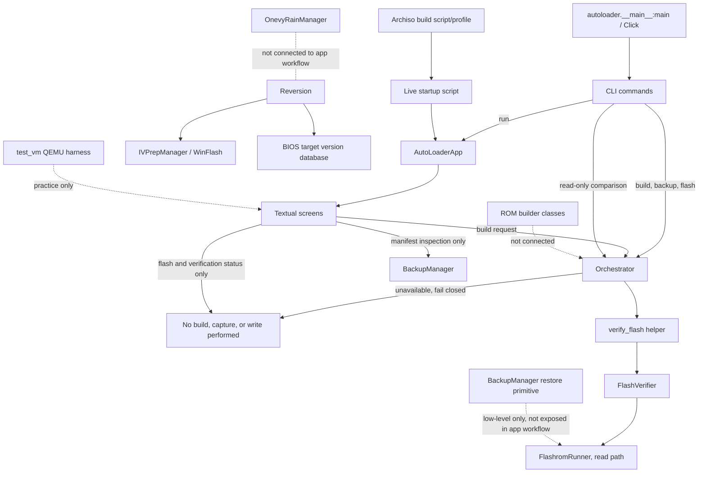

# Current architecture and Phase 01 target

## Current call paths

At baseline, the CLI `flash` path bypassed the orchestrator while TUI build and flash completion were simulated. Phase 01 quarantines all application CLI physical writes, routes build/backup/flash requests to explicit unavailable outcomes, and removes false success. The TUI's build request uses the same orchestrator; capture and write controls remain disabled. Verification uses the shared orchestrator and can perform a read-only comparison when invoked. The compatibility and authorized workflow controller belongs to Phase 02.

## Main modules

| Concern | Current modules |
|---|---|
| Entry and configuration | `autoloader/__main__.py`, `autoloader/app.py`, `autoloader/config.py` |
| Shared state/work | `autoloader/orchestrator.py` |
| Detection and compatibility data | `autoloader/detection/*`, `autoloader/database/*` |
| ROM preparation | `autoloader/rom_builder/*` |
| Flash, verification, backup | `autoloader/flasher/*` |
| 1vyrain unlock | `autoloader/flasher/onevy.py` (`OnevyRainManager`) |
| BIOS targets and downgrade | `autoloader/database/bios_versions.py`, `autoloader/reversion/{chains,ivprep,winflash}.py` |
| Backup restore | `autoloader/flasher/backup.py` (`restore_from_backup`, physical write surface) |
| UI | `autoloader/ui/screens/*`, `autoloader/ui/widgets/*` |
| Live USB | `usb_builder/build_usb.sh`, `usb_builder/archiso_profile/*` |
| VM/practice harness | `test_vm/launch_vm.py`, `test_vm/launch_vm.bat`, `test_vm/mock_chips/*` |
| Tests | `tests/*` |

## Target direction

Phase 01 quarantines physical CLI writes and removes fake completion paths. Phases 02–03 should replace unavailable outcomes with one model-specific, validated operation plan and backend interface. The CLI and Textual screens should request operations through that interface. Backends must return structured outcomes; UI progress and navigation must reflect those outcomes. A simulation backend must be unable to invoke physical writes. Real-device hardware validation remains a separate acceptance layer.
