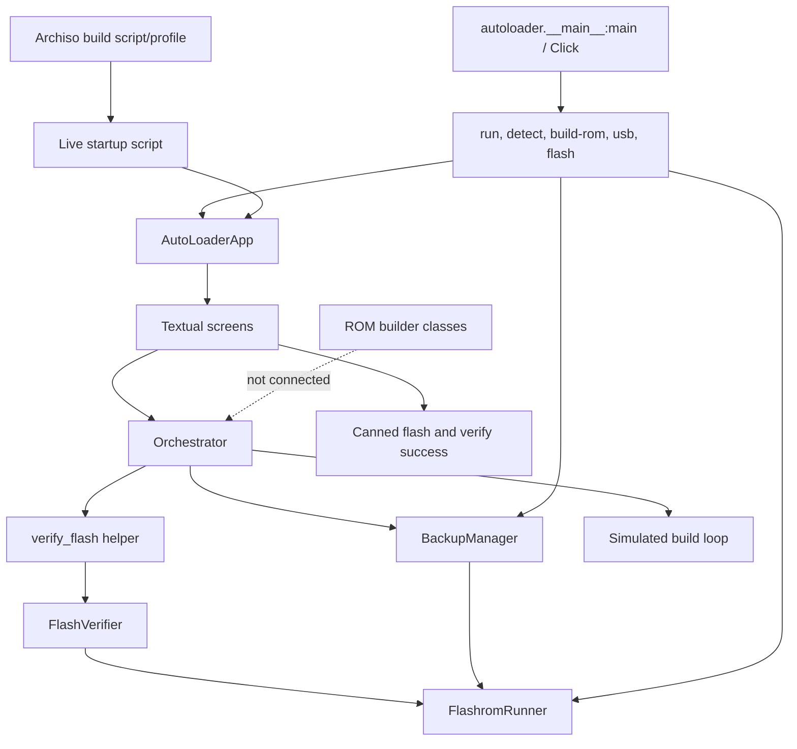

# Current architecture and Phase 01 target

## Current call paths

The CLI's `flash` path bypasses the orchestrator, while TUI build and flash completion are simulated. The current API is therefore not one operational, shared workflow backend. Phase 01 removes false success and makes unavailable operations fail closed; the compatibility and authorized workflow controller belongs to Phase 02.

## Main modules

| Concern | Current modules |
|---|---|
| Entry and configuration | `autoloader/__main__.py`, `autoloader/app.py`, `autoloader/config.py` |
| Shared state/work | `autoloader/orchestrator.py` |
| Detection and compatibility data | `autoloader/detection/*`, `autoloader/database/*` |
| ROM preparation | `autoloader/rom_builder/*` |
| Flash, verification, backup | `autoloader/flasher/*` |
| IVprep/reversion | `autoloader/reversion/*` |
| UI | `autoloader/ui/screens/*`, `autoloader/ui/widgets/*` |
| Live USB | `usb_builder/build_usb.sh`, `usb_builder/archiso_profile/*` |
| Tests | `tests/*` |

## Target direction

Phases 02–03 should introduce one model-specific, validated operation plan and backend interface. The CLI and Textual screens should request operations through that interface. Backends must return structured outcomes; UI progress and navigation must reflect those outcomes. A simulation backend must be unable to invoke physical writes. Real-device hardware validation remains a separate acceptance layer.
